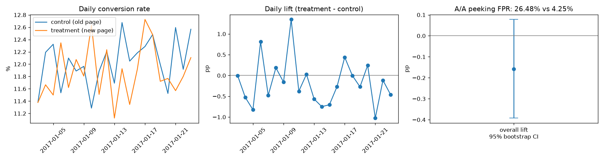

# E-commerce Landing Page A/B Test: Ship or Not?

An e-commerce company tested a redesigned landing page (treatment) against the current one (control) on ~294K users over 23 days. The question: **does the new page increase purchase conversion enough to launch?**

**Decision: do not ship.** The new page converts at 11.88% vs 12.04% for the old page (−0.16 pp, 95% CI [−0.39, +0.08] pp, p = 0.19). There is only a 9.5% posterior probability the new page is better, and no country segment benefits.



## What the analysis does

| Step | Method | Result |
|---|---|---|
| Data quality (SQL) | DuckDB audit of assignment and duplicates | 3,893 rows where group ≠ page shown, plus duplicate logs; 1.3% of rows removed → 290,584 users |
| Sample ratio mismatch | χ² test of arm sizes vs 50/50 | 145,274 vs 145,310, p = 0.95; randomization is healthy |
| Power analysis | Cohen's h, α = 0.05, power = 0.8 | MDE = 0.34 pp (2.8% relative). A 1% relative lift would need ~1.15M users/arm (~174 days) |
| Primary test | Two-proportion z-test, Wald and bootstrap CIs (20K resamples) | −0.158 pp, p = 0.19 (two-sided); one-sided p = 0.91 for "new is better" |
| Bayesian | Beta-Binomial posteriors | P(new > old) = 9.5%; expected loss if shipped = 0.16 pp |
| Peeking risk | 4,000 simulated A/A tests on this experiment's daily traffic | Checking daily and stopping at p < 0.05 gives a **26.5% false-positive rate** vs 4.3% at a fixed horizon |
| Segments | Per-country z-tests with Holm correction; logistic regression with treatment × country interaction | No country significant after correction; interaction LR test p = 0.29 |
| Novelty effect | Trend in daily lift | Slope −0.013 pp/day, p = 0.53; no novelty or change-aversion effect |

All numbers are in [`results/results.json`](results/results.json).

## Recommendation

1. Keep the old page. The new one is very unlikely to help, and the most plausible outcome is a small loss.
2. The test was powered to catch a 2.8% relative lift. If the business cares about smaller lifts, rerunning for longer would not be worth it at current traffic (~13K users/day): a 1% lift needs ~6 months.
3. Fix the logging bug behind the 3.9K mismatched assignments before the next experiment.
4. Decide the test length up front. The A/A simulation shows that daily peeking would have produced a false "win" about one time in four.

## Project layout

```
sql/01_data_quality.sql        assignment, duplicate and date-range audit
sql/02_clean_and_metrics.sql   cleaning (window function dedup), arm/day/country metrics
analysis.py                    stats: SRM, power, z-test, bootstrap, Bayesian, peeking sim, segments, novelty
results/                       results.json + summary.png
```

## Run it

Data: `ab_data.csv` and `countries.csv` from the Udacity "Analyze A/B Test Results" project (also on Kaggle). Put both in `data/`.

```bash
python -m venv .venv && .venv/bin/pip install -r requirements.txt
.venv/bin/python analysis.py data/ab_data.csv data/countries.csv
```
